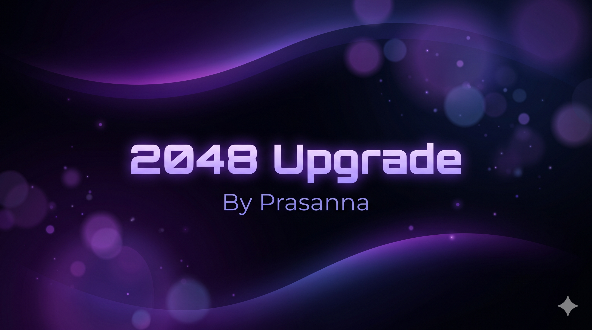

# 🎮 2048 Upgrade

<div align="center">

[](https://prasannaone.github.io/2048-Upgrade/)

*A sleek, zero-distraction 2048 PWA with full-screen swipe gestures, tactile haptics, and OLED dark mode.*



</div>

---

## ✨ Features

* **Full-Screen Omni Swipe:** Swipe anywhere on the screen—no need to keep your thumb confined inside the grid.
* **15-Step Undo History:** Made a slip? Step backward up to 15 moves seamlessly.
* **Tactile Haptics & Web Audio:** Micro-vibrations and synthesized pitch-scaling audio on merges.
* **OLED Dark & Light Themes:** Crisp neon-gradient tiles over a pitch-black OLED canvas or clean light mode.
* **Offline-Ready PWA:** Installs straight to your home screen with automatic state & best-score persistence.

---

## 🚀 Run Locally

```bash
git clone https://github.com/PrasannaOne/2048-Upgrade.git
cd 2048-Upgrade
```
Open `index.html` in any browser.

---

<div align="center">
  <p>Crafted by <a href="https://github.com/PrasannaOne">Prasanna</a> • <a href="https://t.me/prasannaone">@prasannaone</a></p>
</div>
